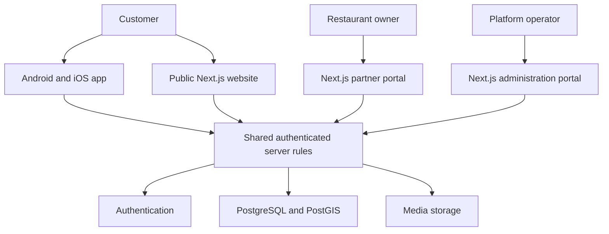

# Food Go architecture

## Purpose

Food Go combines food discovery with a restaurant marketplace. Restaurants should enter their information once and manage it themselves. Customers should be able to discover that information on the website and mobile apps, while the game uses the same approved venues and dishes.

## Application boundaries

| Part                  | Technology                                   | Responsibility                                                              |
| --------------------- | -------------------------------------------- | --------------------------------------------------------------------------- |
| Public website        | Next.js in `apps/web`                        | Discover venues, explain the product, and provide searchable venue pages.   |
| Partner portal        | Next.js in `apps/web`                        | Venue onboarding, venue information, dishes, offers, and staff access.      |
| Administration portal | Next.js in `apps/web`                        | Verification exceptions, moderation, disputes, and game configuration.      |
| Android and iOS       | React Native with Expo in `apps/mobile`      | Mobile discovery, collections, quests, and explorer profiles.               |
| Shared domain         | TypeScript and Zod in `packages/domain`      | Common validation and domain types.                                         |
| Database              | PostgreSQL with PostGIS, managed by Supabase | Shared records, nearby searches, constraints, and row-level access control. |
| Authentication        | Supabase Auth when configured                | Account identity and sessions.                                              |
| Media storage         | Object storage when configured               | Venue photos and menu files, with controlled access and separate backups.   |

The first milestone creates the local application foundations and database design. A cloud service is not connected simply because a configuration example or SQL migration exists.

This diagram shows the intended connected architecture. Unconfigured services must stay unavailable rather than silently acting as a production backend.

## Shared data principles

- A venue has one canonical record. The marketplace and game reference that record.
- An organisation can manage several venues. Membership belongs to the organisation, with explicit staff roles.
- A venue owner can edit permitted venue information. Ownership does not confer authority to approve the venue, change platform roles, or award rewards.
- A canonical food catalogue groups comparable dishes. A restaurant's menu dish can reference a catalogue food without replacing its own menu name or description.
- A venue visit and a dish experience are separate records. A check-in must not automatically assert that a particular dish was eaten.
- Verification, rewards, offer redemption, and billing decisions belong on a trusted server.
- Public explorer information and private account or visit information require separate exposure rules.

## Self-service onboarding

The intended production process is:

1. The owner creates an account and verifies their email address.
2. The owner searches for an existing venue or starts a new listing.
3. The platform checks for duplicates and verifies the owner's authority.
4. The owner completes venue details, menus, photos, and optional game participation.
5. The server validates required information and publishes only when the applicable checks pass.
6. Exceptions enter an operator review queue.

Five to ten minutes is a form-completion target for owners with their information ready. It is not a guarantee that ownership verification completes immediately.

The first milestone's local onboarding draft is a preview of this journey. It does not verify ownership or publish a restaurant.

## Geography and maps

The data model supports Australian states and territories, addresses, and location-based search. A national launch does not require one server in each state. The recommended starting region for the database and server functions is Sydney, subject to final hosting configuration.

Venue information must come from owners or a source with an appropriate licence. A map provider is not automatically a licence to copy a national restaurant directory, its reviews, or its photos.

In the first milestone, map examples are illustrative. They are not live GPS, verified venue locations, or evidence that a user has visited a place. Production maps will query approved participating venues from Food Go's own database.

The mobile app should request foreground location only when needed and provide suburb or postcode search when permission is declined. Regional connectivity requires useful loading, empty, offline, and retry states.

## Security boundaries

The browser and mobile device are untrusted clients. Hidden interface controls are not access control. Database policies and server checks must independently enforce who can read and change each record.

Key boundaries include:

- A customer cannot act as an organisation member by editing a request.
- One organisation cannot read another organisation's private records.
- An owner cannot approve their own venue or promote their own membership.
- A client cannot create a verified check-in or award itself points.
- A server-only credential cannot be shipped in the web bundle or mobile application.
- A missing cloud configuration cannot enable an insecure fallback write endpoint.

See [security documentation](security/) for the detailed threat model and verification requirements.

## Environments and delivery

Use separate local, test, and production configuration. Production data and credentials must not be used for screenshots, routine local development, or test fixtures.

The repository should contain repeatable setup instructions, dependency locking, type checks, relevant tests, production build checks, and dependency scanning. These checks reduce avoidable failures but do not prove that deployed services are secure.

Before launch, test access policies against a real disposable database, test restores for database and media backups, verify mail delivery and domain authentication, and validate both native platforms on physical devices.
