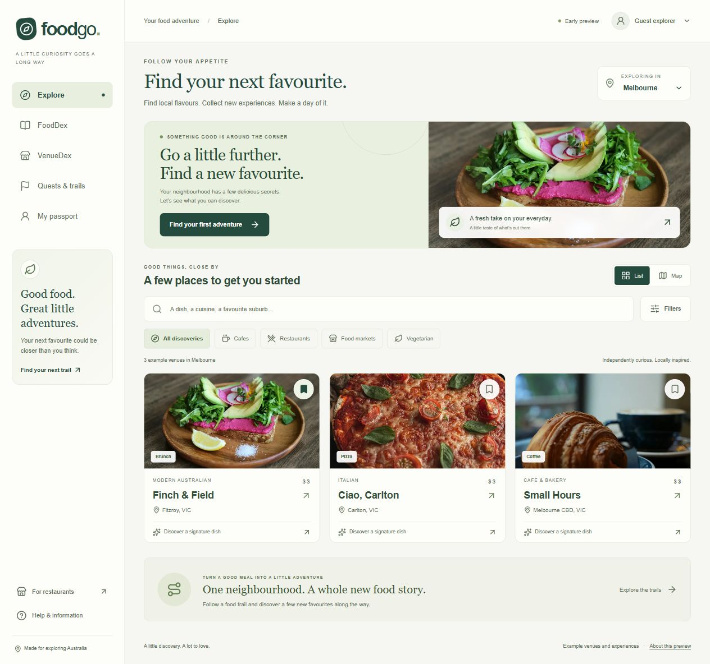
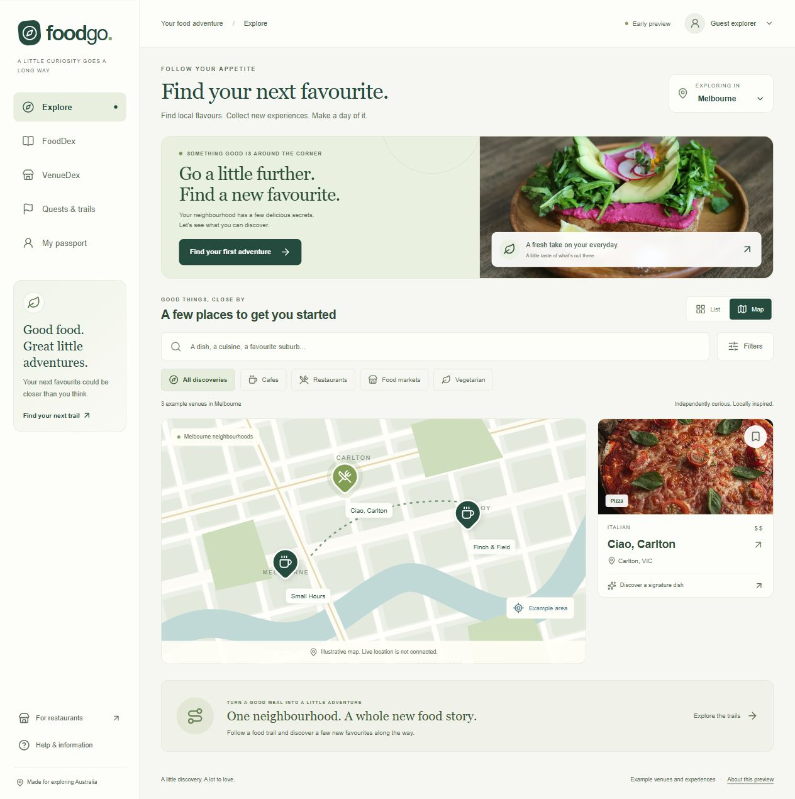
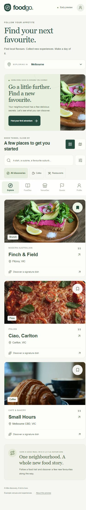
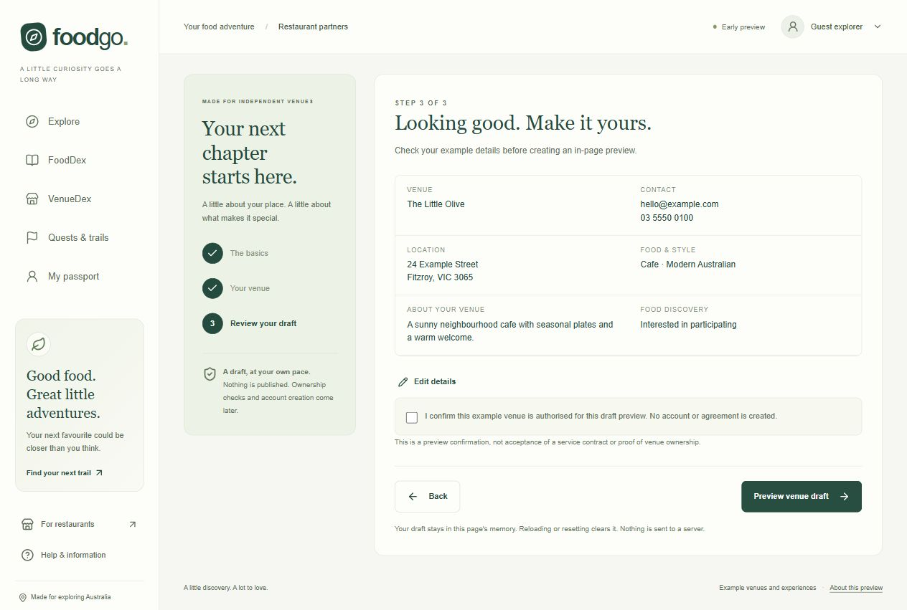

# Milestone 01: foundation

Date: 10 November 2026.

Status: foundation implemented. Local checks, recorded browser interactions, and the tested desktop and mobile-width layouts pass. Native device testing and live database verification remain required before connected production use.

## Goal

Create a reviewable starting point for Food Go across the website and mobile application, while establishing the shared data and security boundaries needed for self-service restaurant onboarding.

## What this milestone covers

| Area                | Delivered result                                                                                                 | Verification status                                                                                                          |
| ------------------- | ---------------------------------------------------------------------------------------------------------------- | ---------------------------------------------------------------------------------------------------------------------------- |
| Project structure   | Next.js web, Expo mobile, and shared domain workspaces.                                                          | Clean dependency installation and both application type checks pass.                                                         |
| Discovery interface | Example venues, search, category filters, saved places, collections, and quest plans.                            | Search, bookmark persistence, quest planning, example map selection, and the tested responsive layouts pass browser checks.  |
| Venue onboarding    | Three-step draft builder with shared validation, review, and an in-page preview.                                 | Invalid fields, focus handling, valid completion, and the final preview checked in the browser.                              |
| Mobile foundation   | Five-tab mobile experience with explicit example content.                                                        | Android and iOS production JavaScript exports and the Expo fingerprint smoke check pass. Native device runtime not verified. |
| Database            | SQL schema and tenant access policy foundation.                                                                  | Source conventions reviewed. The 23 live database assertions have not been run.                                              |
| Security            | Nonce-based browser script policy, response headers, disabled writes, threat model, and production requirements. | Eight static convention tests and 54 local HTTP assertions pass. This is not a penetration test.                             |
| Delivery checks     | Repeatable root commands, dependency lockfile, and CI configuration.                                             | Local checks, production build, and dependency audits pass. A remote CI run has not been observed.                           |

This is a development foundation. Example content and local drafts do not represent approved restaurants, verified visits, live bookings, or production accounts.

## Desktop discovery

Captured from the actual desktop discovery interface. The screenshot shows the main discovery journey, example venues, category controls, and saved-place actions.

The page helps an explorer choose a city, find a dish or suburb, narrow the venue type, and save a place for later. The restrained green and neutral palette keeps attention on the food photographs and the next useful action. At the tested desktop width, the page has no horizontal overflow or nested vertical scroll areas.

Recorded browser checks found one result for an Italian search and two cafe results. Saving Finch & Field carried through to VenueDex as one saved example, while verified visits stayed at zero.

## Example map

Captured from the actual map view. Selecting the Ciao, Carlton marker changed the accompanying venue card in the browser check.

The map gives an alternative way to browse the same example venues. It is an illustration for this milestone. It does not use live GPS or confirm a visit.

## Mobile-width discovery

Captured from the actual web interface at a requested 390 by 844 browser viewport. This is a mobile-width browser screenshot, not a native Android or iOS screenshot.

The mobile layout keeps the discovery journey in one main scrolling page, with navigation at the bottom and controls that reflow to the available width. No horizontal overflow or nested vertical scroll areas were found on the checked Explore, FoodDex, Quests, guest profile, and partner onboarding screens.

The mobile Filters control expanded and collapsed the correct panel. Choosing Sydney showed zero example venues rather than inventing listings. The return-to-Melbourne action restored the example area.

## Recorded layout measurements

| Browser layout                                                      | Available content width             | Document scroll width   | Nested vertical scroll areas | Result                                                                      |
| ------------------------------------------------------------------- | ----------------------------------- | ----------------------- | ---------------------------- | --------------------------------------------------------------------------- |
| Desktop discovery, 1,265-pixel viewport width                       | 1,265 px                            | 1,265 px                | 0                            | No horizontal overflow.                                                     |
| Mobile-width discovery, requested 390 by 844 viewport               | 375 px                              | 375 px                  | 0                            | No horizontal overflow. The browser scrollbar occupies the remaining width. |
| Mobile-width FoodDex, Quests, guest profile, and partner onboarding | Matched each page's available width | Matched available width | 0 on each checked page       | No horizontal overflow or competing vertical scroll panels.                 |

These are browser measurements at the stated widths. They do not replace native device, screen-reader, or larger accessibility-text testing.

## Partner onboarding

Captured from the actual three-step onboarding review using example information. The saved screenshot shows the owner checking the draft details before making an in-page preview.

The flow groups information into the basics, venue details, and a final review so an owner does not face a long form at once. Validation identifies missing or invalid fields and moves focus to the first field that needs attention. Owners can go back and edit their details before continuing.

The browser check completed all three steps and reached **Draft preview ready**. The draft stays in page memory. It is not saved to the backend, submitted, ownership-verified, or published.

## Security implemented in this stage

The foundation includes:

- Shared strict validation for venue draft data and bounded public search requests.
- A fresh per-request browser script nonce, applied to framework scripts. The production script policy does not permit unsafe evaluation.
- Response headers that block framing, reduce content-type confusion, and omit the framework identification header.
- A venue-write endpoint that rejects missing or untrusted origins and stays unavailable even for a trusted origin in this preview.
- Tenant-aware database policies and restricted client grants. Clients cannot approve venues, elevate membership roles, create verified visits, or award rewards.
- Clearly separated public example content and non-sensitive saved browser preferences.

See the [source review](../security/review-01.md), [web controls](../security/web-controls.md), and [dependency review](../security/dependency-review.md) for their scope and limitations.

No software can be guaranteed impossible to hack. Security must be checked as the connected workflows, deployment, and operational processes are added.

## Checks performed

| Check                                    | Result                          | Evidence or limitation                                                                                                                                                                                                                                         |
| ---------------------------------------- | ------------------------------- | -------------------------------------------------------------------------------------------------------------------------------------------------------------------------------------------------------------------------------------------------------------- |
| Clean dependency installation            | Passed                          | `npm ci` completed successfully and reported zero vulnerabilities.                                                                                                                                                                                             |
| Workspace type checks and behavior tests | Passed                          | `npm run check`: web and mobile TypeScript checks, plus nine domain and behavior tests.                                                                                                                                                                        |
| Static security conventions              | Passed                          | `npm run test:security`: eight checks. These inspect conventions, not live database behavior.                                                                                                                                                                  |
| Web production build                     | Passed                          | `npm run build:web` completed with Next.js 16.4.6.                                                                                                                                                                                                             |
| Production dependency audit              | Passed                          | `npm audit --omit=dev --audit-level=moderate` reported zero vulnerabilities.                                                                                                                                                                                   |
| Local HTTP assertions                    | Passed                          | `npm run check:web`: 54 assertions covering routes, changing nonces, framework script nonces, production policy, headers, bounded search, disabled writes, and real 404 responses.                                                                             |
| Desktop interactions                     | Passed for the recorded flows   | Italian search: one result. Cafe filter: two results. Saved Finch & Field persisted into VenueDex: one saved, zero verified. A planned quest appeared under My plan: one planned, zero verified progress. The Ciao, Carlton map marker changed the venue card. |
| Desktop layout                           | Passed at the tested width      | Available width and scroll width were both 1,265 px. No nested vertical scroll areas.                                                                                                                                                                          |
| Mobile-width browser review              | Passed for the recorded screens | Discovery content width and scroll width were both 375 px at the requested 390 by 844 viewport. Zero horizontal overflow and nested vertical scroll areas on Explore, FoodDex, Quests, guest profile, and partner onboarding.                                  |
| Mobile discovery controls                | Passed                          | Filters expanded and collapsed. Sydney showed zero example venues, and the return-to-Melbourne action worked.                                                                                                                                                  |
| Browser console                          | No errors observed              | The recorded final-build browser checks returned an empty console-error list.                                                                                                                                                                                  |
| Screenshot evidence                      | Captured                        | Desktop discovery, example map, mobile-width discovery, and partner onboarding review images are saved in `docs/screenshots`.                                                                                                                                  |
| Onboarding behavior                      | Passed                          | Invalid fields received errors and focus. Valid input advanced through three steps to review and **Draft preview ready** without publishing.                                                                                                                   |
| Android and iOS JavaScript exports       | Passed                          | Both production Hermes exports and the Expo fingerprint smoke check pass. See [mobile verification](01-mobile-verification.md).                                                                                                                                |
| Native Android and iOS runtime           | Not run                         | Requires configured native builds and suitable test devices or simulators.                                                                                                                                                                                     |
| Live database access policies            | Not run                         | The 23 pgTAP assertions require a configured disposable Supabase test project.                                                                                                                                                                                 |
| Remote GitHub CI                         | Not observed                    | A workflow is configured, but the recorded results above are local runs.                                                                                                                                                                                       |

The HTTP checks establish the tested local production server behavior. The browser observations and layout measurements establish the stated flows and widths. Native runtime checks, live SQL tests, deployment configuration, and operational security remain separate requirements.

## Not included yet

- Live authentication and recovery emails.
- Real venue ownership verification or public venue publication.
- Production map services, GPS checks, or secure visit evidence.
- Verified dish consumption, rewards, or competitive rankings.
- Customer payments, restaurant payouts, or confirmed reservation inventory.
- App-store submission or a production deployment.

## Next milestone

Connect the test backend and implement authenticated, verified venue onboarding. Keep the existing example experience reviewable while replacing each preview behavior with a tested connected workflow.

See [the roadmap](../roadmap.md) for acceptance criteria and [architecture](../architecture.md) for the shared system design.
