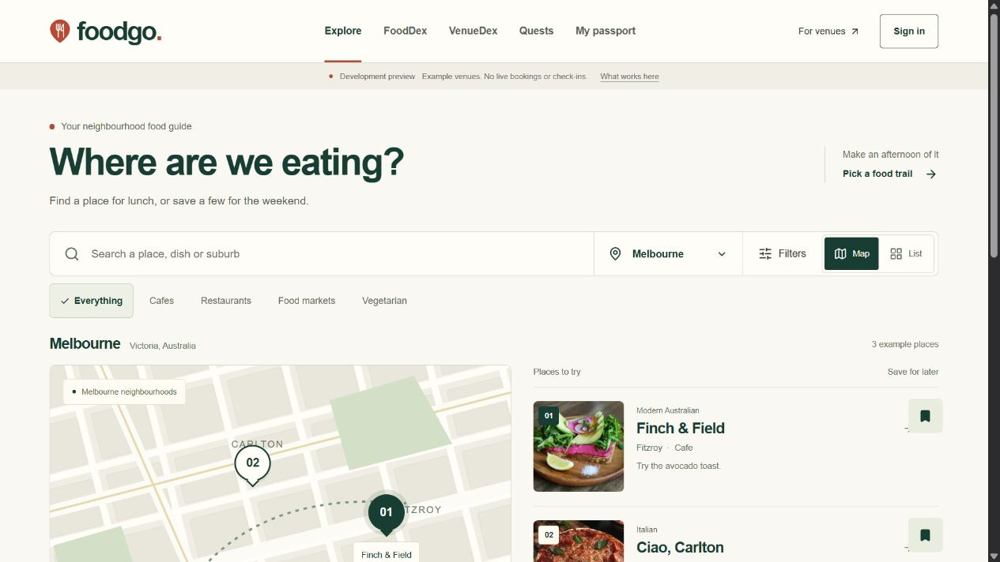
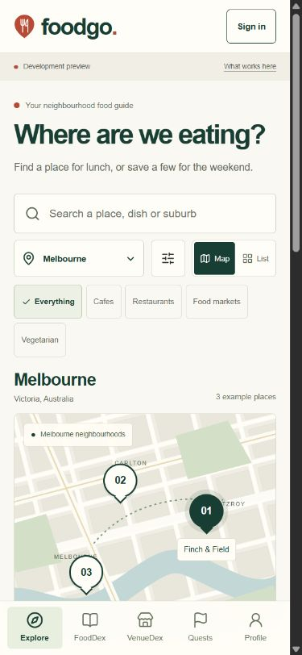
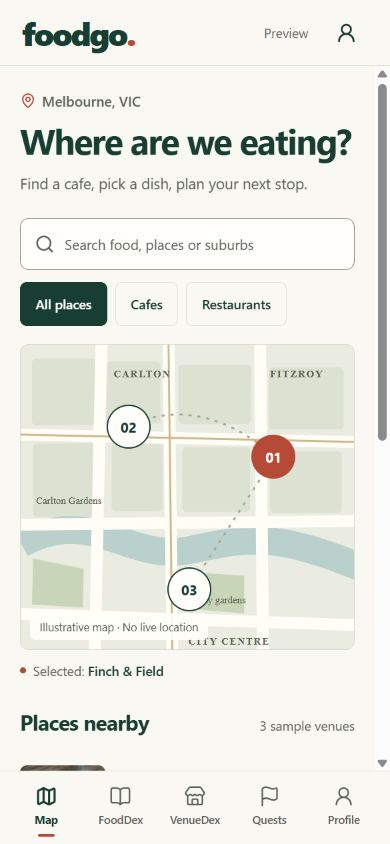
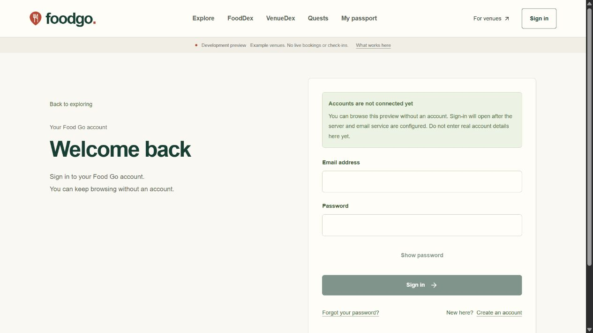

# Milestone 02: interface revision and account foundation

Date: 11 November 2026.

The website and React Native application now use a warmer food-guide style with direct labels, a compact header, numbered map markers and local food photographs. The account screens and server integration are implemented but disabled pending connected testing and completion of the release requirements. This milestone also adds an illustrated Word report for the client.

## What changed

- Replaced the website sidebar and large promotional introduction with horizontal navigation, compact search controls and a map beside venue rows on desktop.
- Reworked the mobile interface using the actual React Native source. The five tabs support example searches, venue saves, separate dish ideas and trail plans.
- Kept one main vertical scroll area. Website panels do not add competing vertical scrollbars. The React Native preview uses one main ScrollView with the outer page locked.
- Added sign-in, registration, forgotten-password and reset-password screens, server account routes, verified identity reads and shared session refresh.
- Added strict account configuration checks, bounded inputs, exact-origin write checks, HttpOnly session cookies, controlled redirects and signed short-lived recovery permissions.
- Documented current behaviour, remaining development, subscription timing and client responsibilities in the Word report.

The example website bookmarks remain in this browser. Mobile saves and plans last only for the current app session. They are not shared with an account. Example venues currently cover Melbourne; choosing an unsupported city shows an empty result.

## Screenshots

### Website discovery

### Website at a phone width

### React Native interface through Expo Web

This capture runs the mobile application source in a browser. It is not a native Android or iPhone device capture.

### Account connection state

## Verification

| Check | Result and scope |
| --- | --- |
| Workspace checks | Both TypeScript checks and all 14 domain and behaviour tests pass. |
| Static security checks | All 8 convention checks pass. These are not a penetration test. |
| Website production build | Passed after the final interface and account integration changes. |
| Website HTTP checks | All 87 assertions pass against the local production preview. |
| Dependency advisory check | Zero known production dependency vulnerabilities reported on 11 November 2026. |
| Mobile exports | Android, iOS and Expo web production JavaScript exports pass. These are not signed store packages. |
| Mobile preview boundaries | All 10 local server assertions pass. |
| Browser interaction review | Example search, category filters, map selection, bookmarks, trail planning and restaurant draft review checked. Disabled accounts are clearly labelled. |
| Browser layout | No horizontal overflow or nested website scroll areas on the checked desktop and phone-width routes. The native browser preview has one main scrolling area. |
| Browser console | No console errors recorded on the final desktop review tab. |
| Live account and email flows | Not run. A client-owned test project and sender are required. |
| Live database assertions | The 23 database policy assertions have not been run. |
| Native phones and remote CI | Native installation and device checks remain pending. A remote CI run has not been observed. |

See the separate [identity verification record](02-identity-verification.md) and [mobile verification record](02-mobile-verification.md) for the detailed evidence and limitations.

## Remaining release work

Before enabling public accounts, implement account deletion, complete CAPTCHA and abuse protection, add durable single-use recovery consumption and test sessions and email flows against the provider. Apply and test database policies in an isolated test environment. No real account was created and no recovery email was sent during this local review.

The live product still needs venue ownership checks, server drafts, secure uploads, approved publication, live maps, secure check-ins, separate dish evidence, rewards, offers, bookings, partner management and administration. Community features and payments need their agreed business rules and operational support.

No service can be guaranteed impossible to hack. The current controls establish specific boundaries; release also depends on live verification, deployment settings, updates, monitoring and backup recovery.

## Client handover

The [Word report](../deliverables/Food-Go-Development-Report.docx) explains the current screens and technical work in simple English. Its final sections list subscription timing and the accounts, content and decisions needed from the project owner.

The report contains 15 pages and 11 screenshots. The bundled DOCX renderer could not run because this Windows runtime does not include LibreOffice. The report was instead opened in Microsoft Word and exported through its native PDF interface for layout verification. Bundled Poppler rendered the PDF to page images; all 15 pages were visually checked. The PDF and page images remain internal QA files.

The next step is a separate client-owned Supabase test project and a domain email sender. Free allowances can support initial connected testing. No paid service is required to review this local milestone.
