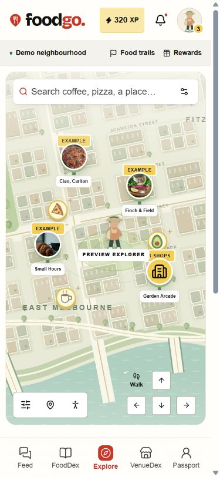

# Compact phone map controls

14 November 2026. The owner marked the phone's stacked search/filter/trail area and lower map controls, asking for smaller items so the map is clearer.

The phone now opens with one slim search bar. Its settings button reveals filters and the trail or selected-place Maps shortcut when needed. The view-tools button opens zoom, reset, touch-drag and motion controls on demand. Places and Avatar remain beside it. Normal phones use a single-row utility group; narrow phones use a small two-column group.

Walking stays directly on the map. Painted arrow buttons are 32px with smaller icons, inside unchanged 44px tap targets. Transparent gaps show the map behind them. Filter selection and Escape close their popover and restore focus to settings. Popup backgrounds receive pointer events so tapping their gaps does not drag the map beneath them.

## Verification

- Web typecheck and production build passed.
- Browser review covered desktop 1280×720, phone 390×844 and short phone 320×568. No document horizontal overflow was observed.
- On the 390px phone, the search measured about 45px high and the utility group about 133×45px. The old lower group used two rows. The search input retains 16px type to avoid phone input zoom.
- On the short phone the utility group measured about 89×89px; the scene remained at top 126.7px and bottom 475.7px in its 568px viewport.
- Filtering changed the venues and restored focus to settings; Everything restored the full set. Zoom changed the scene to 1.15 scale. Escape dismissed tools and restored focus to their opener.
- A direct arrow click moved the explorer from 54% to 58% horizontally with page scroll at zero. Selected-place Google Maps remained available in the settings popover, with the correct real-area search URL.
- Final browser logs contained no warnings or errors. No account, database or reward rule changed. The original prototype remains intact.

The local review server uses `http://127.0.0.1:3002/demo/explore`, leaving the existing port-3000 server untouched. Physical-device/Safari testing remains outstanding. The revision is delivered through the existing Codex handoff branch and PR into `develop`.

