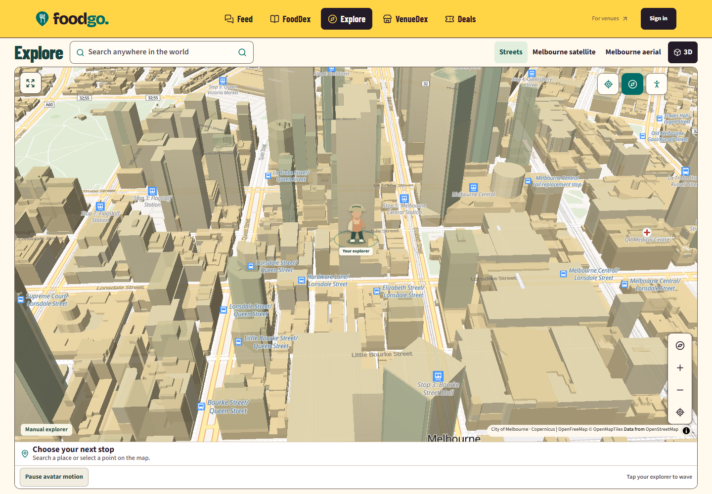
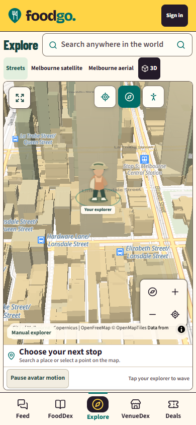
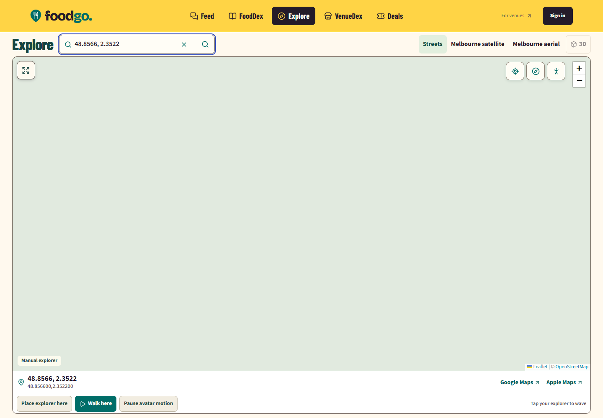

# Worldwide explorer

15 November 2026. The current request extends the real map into an interactive world explorer, keeping the original prototype intact and preserving the owner's changes already on the release branch. The delivery stays on `codex/launch-map-feed-admin` for review into `develop` through PR #9. The hosting team owns rollout.

## Delivered behaviour

- Worldwide OpenFreeMap streets, available OSM 3D buildings and the detailed Melbourne building survey share one canvas. Pan, touch gestures, zoom, perspective, arbitrary selection and external directions remain available.
- Search above the map accepts worldwide place/address queries or direct latitude, longitude input. Published Food Go venues use approved coordinates; co-located shops share a marker and directory. World search does not turn provider POIs into partner venues.
- Street, satellite and aerial choices preserve the map. A configured public MapTiler key enables licensed worldwide satellite coverage. Without it, clearly labelled Melbourne imagery overlays the worldwide street map. The default is Streets when no key exists.
- Permission-based foreground location follows the device and shows reported accuracy. No prompt occurs on load. Manual placement remains available after denial or failure. Live planning waits for a real location fix and retains the planned route as fixes update.
- Manual route walking follows provider pedestrian geometry at normal or explicit 4-times speed. Pause, resume, end, hidden-page pause and reduced-motion initial pause are available. Live mode plans a route without simulated movement.
- The map explorer retains radar, idle/action animations and the existing original, 3D and anime avatar choices. Avatar choices are cosmetic browser preferences. Optional controls preserve the map's main viewing area.
- A Leaflet world map retains selection, directions, the avatar, accuracy and route walking when WebGL/style startup fails. It avoids nested keyboard button semantics on marker wrappers.
- Full-map expansion keeps the original canvas, camera and selection, uses native modal focus containment and restores the opener on close.

The account, restaurant, operator, social and server-verified discovery flows from the connected release remain in place. Virtual walking and manual positioning never award verified XP or establish physical arrival. Historical website demo routes remain retired.

## Provider and privacy boundaries

Place search and routing use bounded server adapters. Explicit search avoids provider autocomplete traffic. Default Photon and FOSSGIS foot routing use independent shared database leases, one request per 1.1 seconds across web instances, plus bounded successful-response caches. A missing lease fails visibly. The lease stores no search terms, endpoints or account IDs. Tests verify anonymous callers cannot read its private table or private posts.

The deployment can configure an operated Photon endpoint, an owned OSRM foot router or the supported openrouteservice `foot-walking` API. Public best-effort providers do not establish launch capacity or availability guarantees. Imagery contributors, MapTiler branding and map correction links remain visible.

GPS fixes stay in mounted page state and are cleared from live mode on opt-out, hidden page or unmount. Tile requests reveal the viewed area to their provider. Explicit searches and route endpoints go to their providers. No GPS history is persisted. See [world map operations](../deployment/world-map.md).

## Verification

- Workspace type checks and 122 application tests passed, including geodesic route interpolation, global style composition, validated provider adapters and busy/failure handling.
- Eight repository security checks, the production build and 143 local HTTP assertions passed. The production dependency audit reported zero advisories.
- A local PostgreSQL WASM check passed the six new lease/access assertions. Disposable Supabase CI remains authoritative for the complete 243 rollback-only SQL assertions and enabled signup-to-XP integration.
- Headless Chrome passed 33 UI checks across desktop and a 390 by 844 mobile viewport: world selection, exact directions, visible result pin, closed search panel, fullscreen/focus, avatar apply, route advance/pause/resume/cancel, live-fix updates, opt-out, denial, mobile map fit and the deliberately triggered raster fallback. No browser runtime errors were observed in that final run.
- Browser UI routing/search and positive location fixes used controlled fixtures. Separate provider probes returned actual Photon results in Sri Lanka and a genuine Melbourne FOSSGIS pedestrian route. These checks do not certify hosted account setup, physical-phone GPS, provider uptime, satellite billing or actual-device rendering performance.

Browser QA fixed search-panel focus loss during submission, stale requests after query editing and a missing selection pin for provider results.

## Deployment handoff

Apply pending migrations, including `20261115150442_food_go_map_service_limits.sql`, through the deployment team's release process. No hosted reset or schema change was performed for this map delivery. Configure the optional global satellite key and launch-appropriate routing/search capacity, then run the HTTPS handset checks in the [connected release guide](../deployment/connected-release.md). Brevo sender, SMS delivery, operator provisioning and other release gates remain as documented there.

## Screenshots

Desktop worldwide street renderer, initial Melbourne view:

Phone viewport with the map above the fixed navigation:

Raster fallback, selected Paris coordinates:

