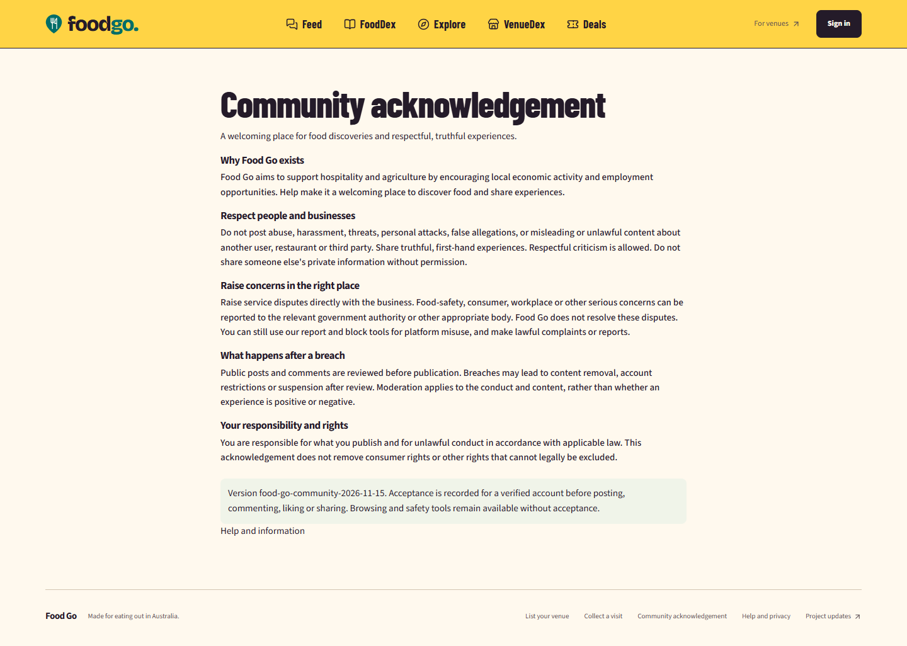
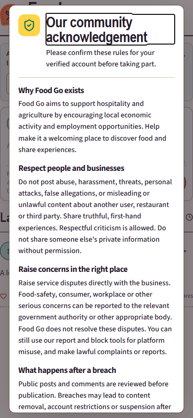

# Community acknowledgement

15 November 2026. The client requested a consent prompt about respectful participation, hospitality/agriculture support, handling disputes and consequences for harmful posts.

## Delivered

- A public `/acknowledgement` page and a permanent footer link publish one shared version of the wording.
- Signup requires an unchecked acknowledgement checkbox for both account types. After confirmation, a verified account explicitly accepts the versioned rules. Existing and phone-created accounts receive the same verified-account prompt.
- The accessible modal permits Continue browsing and Escape. It does not accept on load or scroll. Feed and Passport offer a review entry when needed.
- Successful acceptance records the authenticated account, policy version and server timestamp in a private database ledger. Retries retain the first timestamp. Editable metadata and local storage cannot forge a receipt.
- Database enforcement gates posts, comments, likes and shares, including direct RPC calls. Unaccepted users can still browse, report, block and delete their own posts. All community writes now reject banned Auth accounts.
- Existing operator review remains in place. Decision forms link the acknowledgement and distinguish harmful conduct from truthful, respectful criticism. No sentiment-based automatic ban was introduced.

The original proposal was revised to preserve truthful criticism, consumer rights, lawful reports and platform safety tools. It does not claim automatic liability or bans across separate services. The reasoning, current wording location, legal sources and precise enforcement boundaries are in [the policy record](../security/community-acknowledgement.md).

## Verification

Workspace types and 128 application tests passed, including six new policy API/error tests and updated signup contracts. Eight repository security checks, the production build and 151 local HTTP assertions passed.

The new policy suite passed 35 assertions in local PostgreSQL WASM; the existing community and social-XP suites also passed with consent fixtures. The complete rollback-only SQL suite now contains 278 assertions. The isolated signup-to-XP workflow additionally verifies rejection before consent, first verified acceptance, immutable retry receipts and normal moderated social XP afterwards. Hosted fixtures were not created or changed.

Headless Chrome passed 17 isolated checks using the real consent/feed components with API fixtures, covering unchecked defaults, explicit opt-in, focus, browsing after declining, reporting/blocking, saved acceptance, reload, phone layout and unavailable-state protection. Six additional browser checks exercised the actual built public policy/registration pages with no runtime errors. Physical handset and deployed-provider acceptance remain part of the hosting team's release process.

## Rollout

Apply `20261115163751_food_go_community_acknowledgement.sql` after earlier pending migrations and deploy the matching application. Existing accounts are not silently accepted. A missing migration or mismatched version closes contribution access. The hosting team owns this rollout through PR #9 into `develop`; no hosted database migration was applied for this change.

## Visual evidence

Public acknowledgement page in the built website:

Phone-sized modal in isolated component QA, with fixture Feed content behind the modal:

