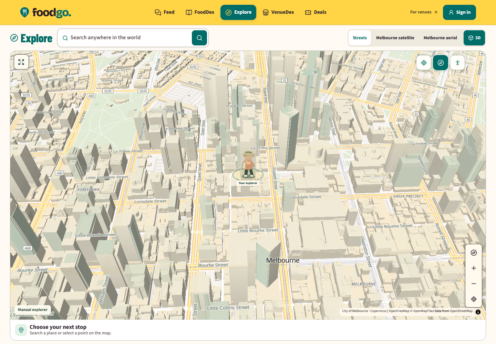
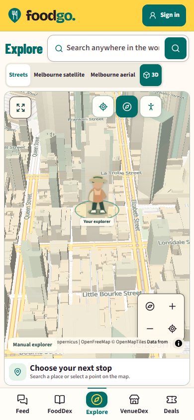

# Connected UI refinement

15 November 2026. The request was to make Food Go more attractive at first glance and make its sections clearer, while retaining working exploration, social, collection and account journeys. The light market-signage identity remains, with stronger hierarchy, more consistent controls and quieter chrome around the map.

## Delivered

Explore has a clearer search rail, a compact imagery switch and a more distinct destination/action dock. Idle motion controls expand with the optional explorer actions instead of occupying a permanent row. Lighter building materials, a less steep camera and more selective label detail improve street readability. Actual geographic coordinates and measured building heights are unchanged. The raster fallback now shows pending tile loading, a useful failure message and a retry that keeps the map mounted.

Shared navigation uses readable body typography, consistent petrol selection and a recognisable saffron masthead. Buttons, form fields and keyboard focus share a coherent treatment. Phone account controls stay compact and the footer clears the fixed navigation, including at 320 px width. Signup reuses the original explorer artwork without adding a WebGL scene.

Feed has a welcoming guest entry, readable story surfaces and a photographic planning rail. Connected empty/unavailable states no longer link to retired example feeds. Passport places the selected avatar, server-derived XP and linked discoveries above the personal wall. Achievements, detailed progression, avatar settings and business controls expand on request.

FoodDex and VenueDex have distinct emblems, clearer segmented views and compact summaries. Verified entries retain their real evidence dates. Promotions use a clearer ticket hierarchy and expiry; restaurant cards use approved listing imagery or a neutral storefront placeholder, in three desktop columns and one phone column. Empty states remain honest about the available published content.

The original standalone prototype, consent wording, database policies, XP rules and provider configuration remain in place. No new dependency, migration or runtime secret is required for this visual pass.

## Research and verification

The [research record](../research/17-ui-refinement.md) separates official-source observations from Food Go design decisions. It covers Duolingo's tab hierarchy, Apple map/motion guidance, the official Pokémon GO map guide and W3C contrast/target guidance.

- Workspace types and 128 application tests passed, including the map style validation. The actual OpenFreeMap style also validated with the customised geographic palette.
- The production build, eight repository security checks and 151 local HTTP assertions passed. An HTTP assertion was corrected to accept an unknown-place 404 independently of whether the catalogue had recovered since an earlier request.
- Desktop 1440 by 1000 and phone 390 by 844 captures covered Explore, Feed, both collections, Deals, Passport, registration and acknowledgement, with no horizontal overflow or browser runtime errors in the final pass. A separate 320 px check confirmed the narrow map toolbar fits; measured visible footer links cleared the phone dock by about 37 px at maximum scroll.
- 33 map interaction checks passed: worldwide selection/directions, avatar choice, street-route movement, pause/resume/cancel, controlled live fixes/denial, full-map focus and raster fallback. Search, routing and positive GPS fixes use controlled fixtures for UI checks.
- 17 consent-component checks passed with the refined shared styles, preserving unchecked opt-in, safe browsing, reporting/blocking and fail-closed contribution controls.
- 47 populated-component checks passed for signed-in Passport, Feed, collections, active promotions and the restaurant grid. APIs and account/content data were isolated fixtures, explicitly labelled in their screenshots. No hosted accounts, posts, venues or awards were created by these checks.
- Six targeted fallback checks passed for pending, failed and retried tiles, successful recovery and continued geographic selection. The successful tile fixture checks loading behaviour, not geographic accuracy. Separate real-provider desktop/phone captures rendered the 3D street map without console, runtime or request failures.
- Representative shared text/action colour pairs measured 5.00:1 to 16.01:1. The design detector reported palette-shade advisories rather than blocking findings; supporting tones are recorded in DESIGN.md.

The verification used desktop Chrome and emulated phone viewports. Physical-handset performance, production provider capacity and retention outcomes remain outside these measurements. The hosting team still owns the PR-only rollout and the existing launch acceptance checks.

## Screenshots

Real geographic map, desktop:

Real geographic map, phone viewport:

Additional views: [Feed](../screenshots/17-feed-desktop.png), [FoodDex phone](../screenshots/17-food-dex-mobile.png), [Deals](../screenshots/17-deals-desktop.png), [signup](../screenshots/17-register-desktop.png), and [populated Passport fixture QA](../screenshots/17-passport-fixture.png).
