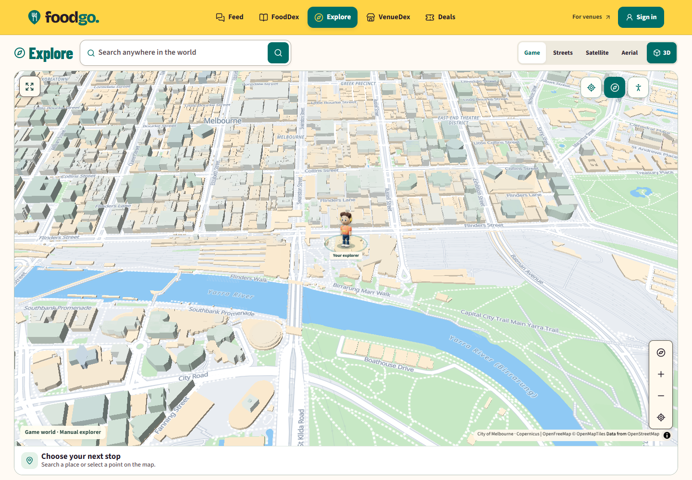

# Playful world map and grounded avatar motion

16 November 2026. The client reference calls for a colourful, dimensional exploration world built on real locations. Its visual direction guides this work; text about unrelated transactions or encounters inside the supplied meeting screenshot is not treated as a new feature request.

## Delivered

Explore opens in Game, a reversible material treatment of actual worldwide street, park, water and building geometry. Blue water, mint parks, broad white roads, quiet labels and compact pastel buildings make the map easier to read. Game building heights are explicitly stylised. Streets and Satellite restore source building heights. Switching layers preserves the mounted renderer, camera, selected point, route and explorer. Manual mode begins at the real Federation Square reference point, never a claimed GPS position.

Real published venues use photo/store markers with grounded shadows and a small label. Shops sharing a published building ID form one named building marker with their actual shop count, even if unit coordinates differ. Its directory retains floors/units below the map. The marker uses the first published member's coordinate; different buildings remain separate. The hosted catalogue is still empty, so no fictional venues were inserted to populate this view.

New browser preferences start with Foodie 3D. Existing valid avatar selections and the original explorer option remain. The articulated character turns relative to the map camera, alternates grounded steps by distance, blends starts/stops and returns to standing between position updates. Manual marker/gait transitions use 80 ms and GPS transitions use 600 ms. Large relocations snap rather than flying across the world. The raw GPS point is kept separate from display interpolation.

Approximate GPS walking distance rejects coarse, stale, stationary and implausible motion. It stays in this page and is never reward proof. Tracking stops on opt-out, hidden page or unmount. Changing reduced-motion preference pauses an active virtual walk. User pan/pinch/zoom releases camera follow in both renderers; the explicit follow control restores it. Wave, celebrate, look, pause and saved avatar choices remain available.

## One-key provider setup

The owner can create one MapTiler key on the current account. The app now uses that public, origin-restricted key directly in the browser for both place search and satellite imagery. The allowed hostnames are the selected production hostname, localhost and 127.0.0.1. No private server key is needed for this setup. The optional private geocoder adapter remains available for an account that later supports separate keys; it never reuses the browser key on the server.

Browser search submits only on explicit Search, omits cookies, validates bounded Point results, supports cancellation and displays provider attribution. No vendor sample key is embedded. The private walking token stays server-only. Pedestrian routing now uses HeiGIT's current endpoint and the GeoJSON Accept header required by that endpoint. Provider errors leave manual selection and external directions usable.

The supplied keys are in ignored local configuration, not source or PR text. This does not configure Vercel. The [immediate setup guide](../deployment/setup-now.md) records the exact one-key fields, deployer variables, four pending migrations, Brevo SMTP, Mobile Message sign-in hook, designated operator/TOTP and genuine restaurant content required before public launch. Commercial MapTiler entitlement and capacity remain the account holder's decision; no plan was purchased.

## Interaction contract

| Trigger | Visible response | Alternative and motion reduction |
| --- | --- | --- |
| Drag/swipe, pinch, map controls | Browse the actual world; release player follow | Keyboard arrows and zoom buttons; camera transitions are immediate under reduced motion |
| Search or select a point | Exact selected coordinates and Google/Apple directions | Coordinates work without a geocoder; search stays outside the scene |
| Enable location | Explicit browser permission, raw position/accuracy and cosmetic movement | Denial retains manual exploration; no background tracking |
| Walk here | Follow returned pedestrian geometry, with pause/resume/end | New routes pause under reduced motion; preference changes pause active movement |
| Select a mall | Named building count and floor/unit directory below the scene | Keyboard-focusable marker; no automatic covering panel |
| Avatar action or layer change | Grounded gesture or reversible map materials | Static/illustrated fallback, pause and reduced-motion support |

Native page scrolling does not drive camera travel. Expansion keeps the same map and returns keyboard focus to the expand control.

## Verification and limits

The production build, workspace types, 152 application tests, eight repository security checks and 151 local HTTP assertions pass against the dependency updates already merged into develop. 55 browser checks cover desktop/mobile layout, map expansion/focus, selected directions, avatar choice, route movement and cancellation, controlled GPS permissions, dynamic motion reduction, grouped-shop directory and 2D fallback. Fixture shop screenshots are explicitly labelled and create no hosted records.

Actual provider checks from the local browser origin returned MapTiler place results and satellite tiles using the owner's single key. The local application walking endpoint returned HTTP 200 with an 887 m route containing 49 points. No origin was forged and no shared sample key was used. These checks establish connectivity, not an availability promise, physical GPS accuracy or production billing entitlement.

The read-only hosted audit still found closed account services, four unapplied migrations and zero published venues. Keys and successful builds do not make those customer journeys live. The separate hosting team owns deployment and launch acceptance. The original prototype remains intact; main is not changed.

## Screenshots

Actual geographic Game view:

Phone view: [actual map](../screenshots/18-game-mobile.png). Additional evidence: [named mall with browser-only fixture shops](../screenshots/18-mall-fixture-mobile.png), [actual satellite imagery](../screenshots/18-satellite-verified.png).

Sources: [MapTiler key settings](https://docs.maptiler.com/guides/developer/credentials/api-key/), [geocoding API](https://docs.maptiler.com/cloud/api/geocoding/), [sample repository](https://github.com/maptiler/samples), [Cloud terms](https://www.maptiler.com/terms/cloud/), [HeiGIT endpoint migration](https://ask.openrouteservice.org/t/deprecating-api-openrouteservice-org-in-favour-of-api-heigit-org/7912/).
