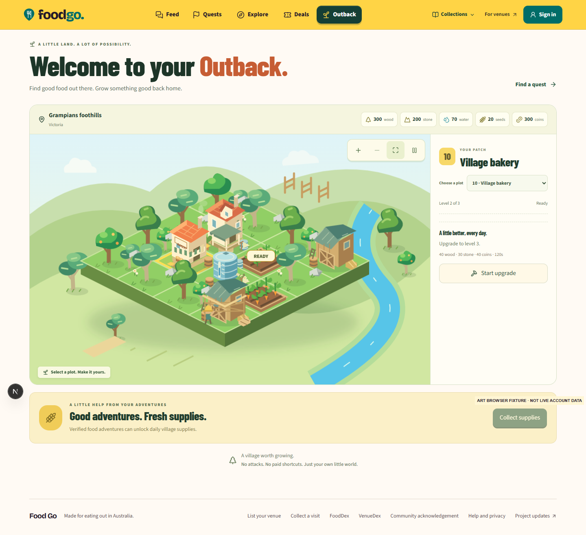

# Five sections, genuine quests and Outback

16 November 2026. This delivery follows the owner's latest five-section request and the phased platform sitemap. Explore remains the first route and the third navigation destination. Original prototype files and the owner's existing work are preserved.

## Delivered behaviour

| Area | Implementation |
| --- | --- |
| Navigation | Feed, Quests, Explore, Deals, Outback. Labelled collection/account controls retain FoodDex, VenueDex and Passport with its personal wall. |
| Explore | Brighter blue water, green parks and warm buildings over real worldwide geometry. Existing satellite, optional GPS, pedestrian routes, avatar actions, grouped shops and external Maps directions remain. Cosmetic walking never earns verified XP. |
| Quests | Verified owners create and submit genuine requests. Independent MFA operators review them. Customers accept published campaigns; fresh single-use staff codes verify completion. Dish, story and promotion evidence is checked server-side. Private feedback allows truthful criticism. |
| Progress | A shared 250-level server-derived ladder, increasingly steep after level 100, with diverse achievement requirements and Mighty/Golden/Legendary status. Existing visits, dishes, social actions and signed-in unique reach remain in the ledger. Passport bars use the actual curve and explain achievement gates. |
| Deals | Exactly Food Deals and Restaurant Deals, searchable by offer, venue and suburb, with expiry ordering and honest empty/unavailable states. Owners choose a category when submitting an offer; operators validate it on publication. Existing offers default to Restaurant Deals. |
| Outback | One permanent Australian state/territory destination, sixteen plots, clearing, construction, three building levels, water and seeds, crops, harvesting and earned daily supplies. All spending, timers and retries are server-owned. Original isometric SVG buildings, crop stages, scenery, bounded ambient motion and deliberate zoom/fit work without another WebGL context. |
| Accounts | Allowlisted sign-in returns include Quests and Outback. Signed Supabase email hook sends confirmation/recovery through Brevo REST, alongside the existing Mobile Message SMS hook. Provider credentials are private; no SMTP password is needed for this email integration. |

The first Outback release is an original peaceful farm, not a licensed Clash of Clans clone. Attacks, paid shortcuts, climate simulation, seasonal events, CardDex, CreatureDex, advanced transaction attribution and billing remain later sitemap phases. Media upload, following and messaging are not silently claimed as delivered Feed features.

## Security and data

An independent source review found and corrected reusable quest proof, missing live-session checks on canonical progress, former-manager self-review, a quota race between managers and withdrawn campaigns retaining active quest slots. Completion atomically consumes its code. Retry receipts cannot duplicate spending or XP. Shared venue locks protect campaign limits; daily quest rewards are capped on the Sydney calendar. New game tables are private, RLS-enabled and not directly writable by clients.

The owner-authorised four previously pending migrations are already installed on Food go (`azccigsctzhbaxoajqst`). Repository filenames match the actual hosted records: `20261116055108`, `20261116055203`, `20261116055307`, `20261116055317`. SQL content was preserved; hosted history was not rewritten. The adventure migration requires the separately recorded CI and hosted rollout receipt before it can be described as installed.

## Verification

- Workspace types, 168 application tests, eight repository security checks and the production Next.js build pass.
- Local PostgreSQL WASM checks pass all 82 adventure and 83 social assertions. This harness stubs Supabase Auth/Storage, PostGIS point and pgTAP helpers, so it is supplementary evidence, not the real-platform result.
- Actual Chrome: 44 adventure interaction checks, 14 village artwork/motion checks and 28 independent Deals/auth-return checks pass, with zero runtime errors. Mobile checks include 320 px and 390 px widths, keyboard access, reduced motion and one document scroll. Populated UI evidence uses explicitly labelled browser fixtures; intercepted sign-in tests create no accounts or outbound messages.
- Disposable Supabase CI now includes the SQL suites, a two-connection campaign-quota test that requires observed lock contention, and genuine-session API assertions for village spending and the complete owner/operator/customer quest lifecycle. Record the actual CI outcome below after it completes.

## Deployment inputs

Supplied Brevo and Mobile Message credentials pass read-only provider checks, including active sender and available SMS credit. No real email or SMS was sent. The complete private environment file and concise README are in the ignored `artifacts/developer-handoff` directory, outside Git. Both Supabase-generated hook signing secrets remain blank until the intended hooks are registered.

The separate deployer must deploy the reviewed PR, connect both Supabase HTTP hooks, copy their signing secrets, configure exact authentication callbacks and perform controlled real inbox/handset acceptance. Vercel currently requires project access for Git author DasuniPathirana or an authorised manual deployment. The public deployment's account gate remains closed, and no real venues have been published. The selected first operator registers and confirms privately, receives an independently verified UUID-based operator grant and enrols TOTP. There is no shared admin password.

The [immediate setup guide](../deployment/setup-now.md) is the operational source for remaining launch actions. A successful build, valid provider key or fixture screenshot does not certify public readiness.

## Screenshots

All pictured village/quest records are labelled browser fixtures, not hosted account data.

[Phone village](../screenshots/19-outback-fixture-mobile.png) · [Phone quests](../screenshots/19-quests-fixture-mobile.png)
